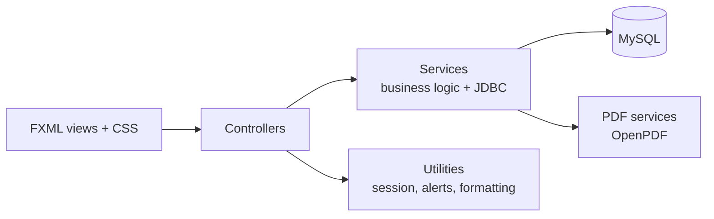
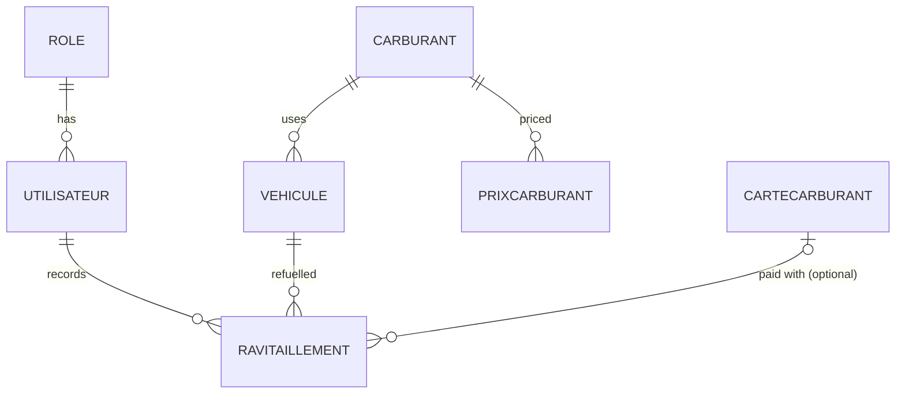

# Fleet Fuel Manager — Vehicle Fleet & Fuel Consumption Management (JavaFX)


Fleet Fuel Manager (*Gestion des Carburants*) is a **desktop application** for supervising a company's vehicle fleet and its fuel expenses. It records vehicles and refuelling operations, computes **real fuel consumption (L/100 km)** from odometer readings, displays **KPIs and charts**, and generates **PDF receipts and reports**.

It is built in **Java 21 with JavaFX** (FXML views, CSS themes, charts), following an **MVC architecture with a service layer** on top of a **MySQL** database accessed through JDBC.

---

## Table of Contents

- [Objectives](#objectives)
- [Features](#features)
- [Tech Stack](#tech-stack)
- [Architecture](#architecture)
- [Data Model](#data-model)
- [Project Structure](#project-structure)
- [Getting Started](#getting-started)
- [Screenshots](#screenshots)
- [Limitations & Future Work](#limitations--future-work)
- [Author](#author)

---

## Objectives

- Centralize fleet data: vehicles, fuel types, fuel cards and refuelling history.
- Monitor fuel costs and detect high-consumption vehicles by comparing **real** consumption with **theoretical** consumption.
- Produce printable documents (receipts and periodic reports) for management.
- Practice desktop application design with JavaFX, MVC and relational database modelling.

## Features

**Authentication**
- Login screen (preceded by a splash screen) checking credentials against the `Utilisateur` table.
- User session with the connected user's name displayed, and logout from every screen.

**Dashboard**
- KPIs: **total refuelling cost** (DH), **number of refuels**, **average real consumption** (L/100 km), computed from consecutive odometer readings per vehicle.
- Charts: cost evolution over the last 3 months (line chart), cost distribution per vehicle (pie chart), real consumption per vehicle (bar chart).

**Vehicle management**
- Create, update and delete vehicles: plate number, brand, model, fuel type, initial and current mileage, theoretical consumption.
- **Live search** by plate number.
- Per-vehicle **refuelling history** with the consumption computed for each refuel.

**Refuelling management**
- Entry form: date, vehicle, driver, location, quantity (L), unit price (DH), odometer reading and an optional **fuel card**.
- **Automatic calculation** of the total amount as the quantity or price is typed.

**Reports**
- Period filter: last 3 months, last 6 months, year.
- Charts: monthly costs, distribution per vehicle, real consumption per vehicle.
- **PDF export** of the report (OpenPDF).

**Printing**
- Filter refuels by date range, with a summary: number of refuels, total litres, total cost and average price per litre.
- Generate a **PDF receipt** for a selected refuel and a **PDF consumption report** for the period; the file is opened automatically.

**User interface**
- **Light / dark theme** toggle and fade-in transitions.

### Business rules

| Metric | Formula |
|---|---|
| Total amount | `quantity × unit price` |
| Real consumption | `quantity × 100 / (odometer(n) − odometer(n−1))` for two consecutive refuels of the same vehicle |

## Tech Stack

| Layer | Technologies |
|---|---|
| Language | Java 21 |
| User interface | JavaFX 21 (FXML, CSS, `javafx.scene.chart`) |
| Persistence | MySQL 8, JDBC (`mysql-connector-j` 9.3.0), SQL scripts |
| Documents | OpenPDF 1.3.30 |
| Build / IDE | Apache Ant, Apache NetBeans (JavaFX project) |

## Architecture



| Package | Responsibility |
|---|---|
| `main` | `MainApp`: application entry point, navigation between views, theme switching |
| `controller` | One JavaFX controller per screen (login, dashboard, vehicles, refuels, reports, printing) |
| `model` | Domain classes: `Vehicule`, `Ravitaillement`, `Carburant`, `CarteCarburant`, `PrixCarburant`, `Utilisateur`, `Role` |
| `service` | Data access with `PreparedStatement`s, statistics, PDF generation, singleton `DatabaseConnection` |
| `util` | Session (`AppSession`), alerts, date and number formatting |
| `resources` | FXML views, CSS themes (light, dark, login), images |

## Data Model



| Table | Content |
|---|---|
| `Role`, `Utilisateur` | Roles and user accounts |
| `Vehicule` | Plate (primary key), brand, model, mileage, commissioning date, theoretical consumption, fuel type |
| `Carburant`, `PrixCarburant` | Fuel types and price history |
| `CarteCarburant` | Fuel cards with holder, spending limit and status |
| `Ravitaillement` | Refuels: date, location, quantity, unit price, total, odometer, vehicle, driver, optional card |

## Project Structure

```
Gestion-de-flotte-automobile/
├── src/
│   ├── main/            # MainApp (entry point)
│   ├── controller/      # JavaFX controllers
│   ├── model/           # Domain classes
│   ├── service/         # Data access, statistics, PDF generation
│   ├── util/            # Session and helpers
│   ├── components/      # Reusable UI component (logo)
│   ├── resources/       # FXML views, CSS themes, images
│   ├── gestionCarburant.sql          # Database schema + initial data
│   ├── insert_donnees_statistiques.sql # 12 months of sample data
│   └── requetes_statistiques_optimisees.sql # Analytical queries, views, indexes
├── lib/                 # JavaFX 21, MySQL Connector/J, OpenPDF jars
├── nbproject/           # NetBeans project configuration
├── build.xml            # Ant build script
├── INSTALL.md / DEMO.md # Installation and demo guides (French)
└── run.bat / run.sh
```

## Getting Started

### Prerequisites

- **JDK 21**
- **MySQL 8**
- **Apache NetBeans** (recommended) or Apache Ant

### 1. Database

```sql
-- Creates the gestion_carburant database, the tables, the admin account and fuel cards
SOURCE src/gestionCarburant.sql;
```

> **Known setup issue:** the scripts never insert the fuel types (`Carburant` table), and the sample data references user accounts with ids 2 to 4, which the base script does not create. Before loading the fuel prices and sample data, insert the fuel types (ids taken from the comments in `insert_donnees_statistiques.sql`):
>
> ```sql
> INSERT INTO Carburant (id_carburant, nom_carburant) VALUES
>   (1, 'Essence SP95'), (2, 'Essence SP98'), (3, 'Diesel'), (4, 'GPL'), (5, 'Ethanol E85');
> ```

Optionally, load 12 months of sample data (5 vehicles, 117 refuels):

```sql
SOURCE src/insert_donnees_statistiques.sql;
```

### 2. Database connection

The connection settings are defined in `src/service/DatabaseConnection.java` (default: `jdbc:mysql://localhost:3306/gestion_carburant`, user `root`, empty password). Update them to match your MySQL installation.

### 3. Run

- **NetBeans:** *File → Open Project*, select the folder, then *Run*.
- **Command line:**

```bash
ant run        # compiles, builds the JAR and runs main.MainApp
```

### 4. Log in

| Login | Password |
|---|---|
| `admin` | `admin123` |

## Screenshots

<!-- TODO: add screenshots to docs/screenshots/ and reference them here, for example:


-->

## Limitations & Future Work

**Security**
- Passwords are stored and compared in plain text: hash them (e.g. BCrypt).
- Database credentials are hard-coded: load them from a configuration file or environment variables (`config.properties` exists but is not read yet).
- Roles are stored with the user but do not restrict access to screens yet.

**Features**
- Record the logged-in user on each refuel (currently only the driver name is stored).
- Expose in the interface the analyses already implemented in `StatistiqueService` and `RapportPDFService`: price evolution, top stations, seasonal analysis and vehicles with abnormal consumption.
- Add a user management screen and fuel card spending-limit checks.

**Engineering**
- Fix the SQL scripts so the database can be initialized in one step.
- Migrate the build to Maven or Gradle and add unit tests (JUnit) for the consumption and statistics logic.
- Add a `.gitignore` and remove build artifacts (`build/`, `nbproject/private/`) from version control.

## Author

**Hind Bassou** — Computer Engineering student, National School of Applied Sciences of Oujda (ENSAO)
GitHub: [@hind-bass](https://github.com/hind-bass)
